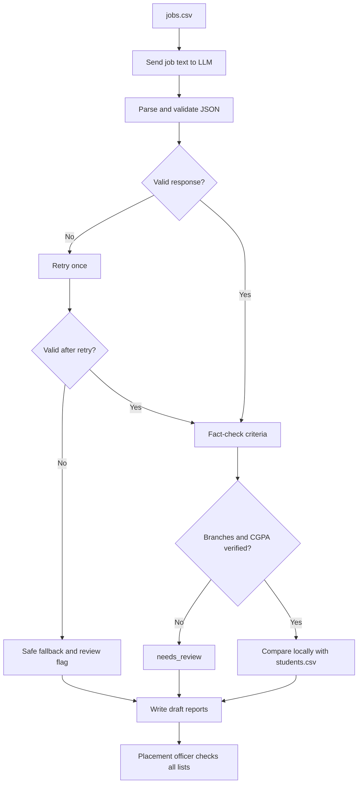

# Placement Eligibility Checker

## 1. Project purpose
A console-based Python application for a college placement cell. It reads company job posts and fictional student records, extracts only explicitly stated eligibility criteria, checks students, and creates draft reports for a placement officer.

## 2. Requirements
- Python 3.10 or later
- `jobs.csv` with at least 8 job posts
- `students.csv` with at least 20 fictional student records
- Internet and an API key for live LLM mode (optional for offline demonstration)

No third-party Python package is required by the program.

## 3. Run offline demo
Open a terminal in this folder and run:

Windows PowerShell:
```powershell
$env:DEMO_MODE="1"
python placement_checker.py
```

Windows Command Prompt:
```cmd
set DEMO_MODE=1
python placement_checker.py
```

macOS/Linux:
```bash
DEMO_MODE=1 python placement_checker.py
```

The offline demo extractor uses simple local pattern matching. It is provided for demonstration and testing; it is NOT an LLM. Explain this honestly during assessment.

## 4. Run with a real LLM
Set an API key as an environment variable; do not write it in the source code.

Windows PowerShell:
```powershell
$env:OPENAI_API_KEY="YOUR_API_KEY"
python placement_checker.py
```

macOS/Linux:
```bash
export OPENAI_API_KEY="YOUR_API_KEY"
python placement_checker.py
```

Optional configuration:
- `OPENAI_MODEL` (default: `gpt-4o-mini`)
- `OPENAI_BASE_URL` (default: OpenAI-compatible Chat Completions endpoint)

Only the job-post text is sent in the LLM request. Student records are processed locally in Python.

## 5. Output files
- `job_summary.csv`: criteria, status and eligible count for every job.
- `eligible.csv`: one row per eligible student per matched job. Every row is marked `PENDING_OFFICER_REVIEW`.
- `review.csv`: posts that need manual review and the reason.
- `summary.txt`: eligible count per job and students not eligible for any matched job.

## 6. Important safeguards
- Exactly five JSON fields are required.
- Invalid extraction is retried once.
- If both attempts fail, a safe fallback is used.
- Branches and numeric criteria are fact-checked against the original post.
- Percentages are never converted into CGPA.
- Missing criteria remain null.
- `needs_review` is used if valid branches or a verified CGPA are missing.
- The placement officer must approve every list before it is shared.

## 7. Run tests
```bash
python -m unittest -v
```

## 8. Flow


## 9. Limitations
The included sample data and offline extractor are for educational demonstration. The live LLM mode depends on a valid API key, network access, provider availability and model configuration. Human review remains mandatory.
